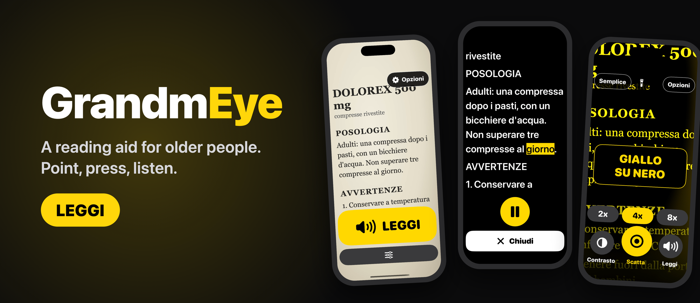
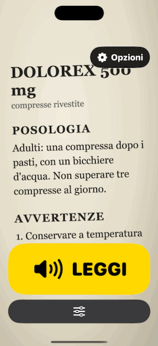
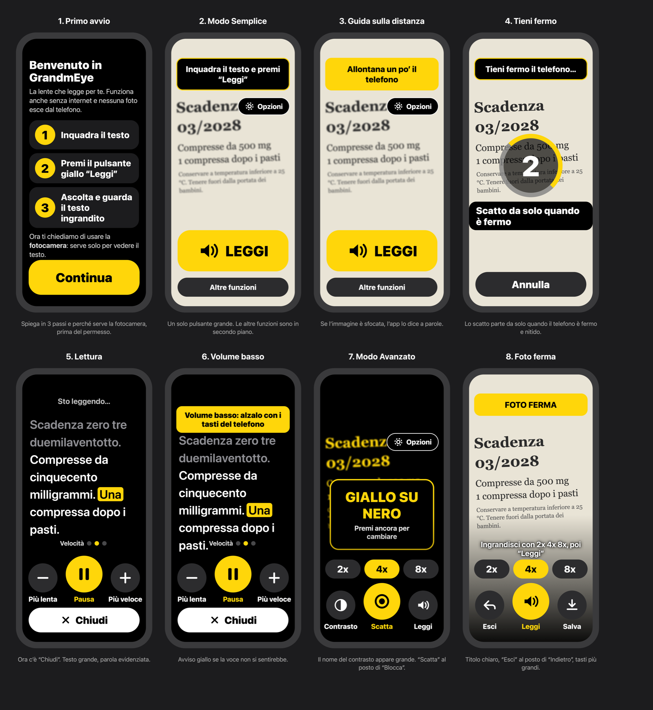

<p align="center"></p>

<p align="center">
  
  
  
  
  
  
</p>

<h1 align="center">GrandmEye</h1>

<p align="center"><b>A reading aid for older people, for iPhone.</b><br>
Point at the small print, press one big button, and listen: everything happens on the device.</p>

## Table of contents

- [About the project](#about-the-project)
- [Features](#features)
- [Design principles](#design-principles)
- [Engineering highlights](#engineering-highlights)
- [Built with](#built-with)
- [Getting started](#getting-started)
- [Usage](#usage)
- [Architecture](#architecture)
- [Privacy](#privacy)
- [Status](#status)
- [License](#license)
- [Author](#author)

## About the project

<table>
<tr>
<td valign="top">

GrandmEye turns the iPhone camera into a magnifier that reads aloud. It is made for people who struggle with medicine leaflets, expiry dates, bills and labels, and who do not want to learn an app: the main screen is one big **LEGGI** (Read) button. Behind it, the app waits until the phone is held still, takes the picture by itself, finds the text with Apple's Vision framework and reads it aloud, highlighting each word as it is spoken.

It is a one-person project. The first version was a camera magnifier with a freeze-frame and a text selector; the current design, described below, was rebuilt after walking through the app as three different users (macular degeneration, hand tremor, first-time smartphone user) and after a relative asked for it.

</td>
<td align="center" width="300"></td>
</tr>
</table>

## Features

- **One-button reading:** the *Simple* mode is the default. Press LEGGI, hold still, listen. No area to draw, nothing to configure.
- **Takes the photo when you are steady:** the gyroscope and accelerometer decide when the phone has stopped moving (with a timeout, so a strong tremor never blocks the app).
- **Tells you when it cannot read:** if little text is found or Vision is unsure, the app says *Allontana* (move back) with a picture and out loud, instead of reading wrong words.
- **Reading that sounds like a page:** paragraphs, headings, lists and words split across lines are rebuilt from the position of each line; the voice pauses between paragraphs and the spoken word is highlighted.
- **Pause and close, nothing else:** the reading screen has big text, one pause button and a close button; it scrolls by itself to keep the paragraph being read in view.
- **Volume warning:** if the phone volume is too low to hear the voice, a banner says so.
- **Advanced mode** (a small control away): three fixed zoom steps (2x, 4x, 8x), a **contrast** button that cycles normal, white on black, yellow on black and black on white live on the camera, a **still photo** you can pinch to zoom and drag, and a torch.
- **Reads what you see:** on a still photo, *Leggi* reads only the part on screen after zooming and moving.
- **Dates and euro amounts read naturally** in the chosen language (for example "5 euro e 50 centesimi").
- **Two languages:** Italian and English, chosen in Settings; the spoken text, the dates and the messages all follow it.

## Design principles

| Principle | What it means in the app |
|---|---|
| **One thing per screen** | The main screen has the Read button, Settings and a small control for the advanced mode. |
| **Pictures before words** | Hints use icons (a phone moving away, a raised hand with a countdown, a crossed speaker); there is no onboarding text. |
| **Large targets** | Primary buttons are 96-130 pt; text uses a rounded, heavy type and high contrast (yellow on black). |
| **Say what to do, not what is wrong** | "Allontana", not an error message. |
| **Safe by default** | A wrong number on a medicine label is worse than no answer, so unsure results are refused and the user is asked to try again. |

<p align="center"></p>

<p align="center"><sub>Design mock-ups from the redesign, not screenshots. The shipped screens follow them with less text.</sub></p>

## Engineering highlights

| Area | What was done |
|---|---|
| **Steadiness detection** | `SteadinessMonitor` reads Core Motion rotation and acceleration; the app needs 1.5 s of stillness before it shoots, with an 8 s timeout. Without motion sensors (the simulator) it falls back to a fixed wait. |
| **Live contrast filters** | Camera frames go through an `AVCaptureVideoDataOutput`; a Core Image pipeline (greyscale, contrast, then a two-colour map) renders them, and the filtered frame is published through a separate observable object so thirty frames a second do not re-render the whole screen. The same filter is applied to still photos off the main thread. |
| **OCR confidence gate** | The recognised text carries a confidence weighted by line length; below a threshold the app treats it as "too close, blurred or shaky" rather than reading it. |
| **Page structure from positions** | `TextStructurer` is a pure function from recognised lines and their boxes to text: it merges pieces on the same row, finds paragraph breaks from the gap between lines, keeps list items on their own line, isolates capitalised headings and rejoins hyphenated words. |
| **Speech** | One `AVSpeechUtterance` per paragraph with a pause between, and a map from each utterance to its offset in the full text so the highlighted word stays correct and the reading view can scroll to its paragraph. If the audio session refuses to activate, the app still speaks. |
| **Visible-area reading** | The still photo works out which part of the image is on screen from the zoom and the position, and crops the original picture to it before recognition. |
| **Concurrency** | The camera runs on its own serial queue; the app target uses main-actor isolation by default and the frame processor is explicitly `nonisolated`. |
| **Localisation** | A String Catalog in two languages, plus a helper that looks a key up in a chosen language, so the voice and the screen never disagree with the device language. |

## Built with

- Swift 5, [SwiftUI](https://developer.apple.com/xcode/swiftui/)
- AVFoundation (camera, speech synthesis), [Vision](https://developer.apple.com/documentation/vision) (text recognition), Core Image (live filters), Core Motion (steadiness), Photos (save)
- No third-party packages

## Getting started

### Prerequisites

- A Mac with Xcode 26 or later
- An iPhone running iOS 26 or later. The camera features need a real device; the simulator only shows the interface.

### Installation

```sh
git clone https://github.com/AntonioNavarra/GrandmEye.git
cd GrandmEye
open GrandmEye.xcodeproj
```

Select your iPhone as the destination and run the `GrandmEye` scheme. There is nothing else to set up: no packages, no keys, no backend. To install on your own phone you need to choose your own signing team in the project settings.

## Usage

1. Open the app and allow the camera.
2. Point the phone at the text and press **LEGGI**. Hold still when the hand and the countdown appear.
3. Listen. Press the pause button to stop and resume, or **Chiudi** to go back.

For more control, tap the sliders control under the button to enter the *advanced* mode: pick 2x, 4x or 8x, cycle the contrast, or press the round camera button to freeze the picture. On a still photo, pinch to zoom, drag to move, then press **Leggi** to read what is on screen. The same switch is in **Opzioni** (Settings).

### Demo mode (debug builds only)

The simulator has no camera, so debug builds accept two launch arguments to record the media in this README. They do not exist in a Release build.

```
-demoImagePath <png>   use this picture as the camera view and as every photo taken
-demoClip YES          drive the app through a paced tour: simple mode, hold still, reading,
                       advanced mode, contrast, still photo with pinch
```

`scripts/record-demo.sh <simulator-udid>` builds, records the screen and cuts it into `docs/demo.gif` with `scripts/clip-to-gif.swift`; the sample picture is `docs/demo/leaflet.png`. The clip shows the real screens and the real text recognition. The simulator's speech voices are unreliable, so when the voice does not start the tour moves the highlighted word by script.

## Architecture

```
GrandmEye/
  GrandmEye.swift          app entry, injects the chosen language
  Models/                  AppSettings, MagnificationSettings, ContrastMode
  ViewModels/              CameraViewModel (camera service, reading flow), SettingsViewModel
  Utilities/               OCRManager (Vision + speech), TextStructurer (page layout),
                           SteadinessMonitor, PhotoManager, Audio/Haptic managers, String+Localized,
                           DemoMode (debug only)
  Views/                   CameraView (simple, advanced, still photo), FreezeView (pinch and pan),
                           TranscriptionView (reading), SettingsView, TextSelectionView (unused crop tool)
  Views/Components/        large buttons, zoom steps, settings card
  Localizable.xcstrings    Italian and English
```

| Decision | Why |
|---|---|
| **The camera service lives on a background queue; the view model is `@MainActor`.** | Session work never blocks the interface. |
| **Page layout is a pure function** (`TextStructurer`). | It can be checked on its own with a handful of lines and boxes, without a camera. |
| **The OCR runs on the original photo, never on the filtered one.** | A colour filter must not change what is read. |
| **The manual crop selector is kept but not used.** | "Read" now reads the whole frame or the visible part; the tool may come back as an option. |

## Privacy

No account, no network access, no analytics. The camera is used to see the text and to take the picture that is read; pictures are saved to the photo library only if you press Save, and the permission asks for add-only access. Motion sensors are used only to know whether the phone is still and nothing is stored. The full policy is in [`privacy.html`](privacy.html); help is in [`support.html`](support.html).

## Status

Version 1.0 is on the App Store. The redesign described here (simple mode, hold-still capture, structured reading, live contrast, pinch on still photos) is on the `miglioramenti-base` branch and has not been released. It builds and it was installed on a physical iPhone, but it has **not yet been tried with the people it was designed for**; the thresholds (how still is "still", how unsure is "too unsure", how large a gap is a new paragraph) are first estimates. There are no automated tests yet.

Known limits: text in several columns is read in top-to-bottom order, so columns can mix; the pinch zooms around the centre of the screen rather than between the fingers; only Italian and English are supported for text recognition and voice.

## License

MIT, see [LICENSE](LICENSE).

## Author

**Antonio Navarra**, software engineer. [GitHub](https://github.com/AntonioNavarra) · [LinkedIn](https://www.linkedin.com/in/antonio-navarra-a33920268/)
